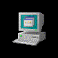
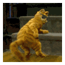
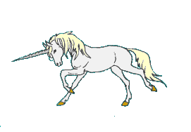
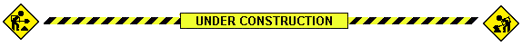

<!-- ======================================= -->
<!-- MUEED SHAH - RETRO INTERNET PROFILE     -->
<!-- ======================================= -->

<!-- RETRO WELCOME BANNER -->

  

<h1>
  WELCOME TO MY CORNER OF THE INTERNET
</h1>

  

 

<pre>
  .--------------------------------------.
  |  USER: MUEED SHAH                     |
  |  STATUS: EXPLORING THE INTERNET       |
  |  MOOD: CREATIVE                       |
  |  LOCATION: SOMEWHERE ON THE WEB      |
  '--------------------------------------'
</pre>

 

<!-- PERSONALITY SECTION -->

<h2>✦ THIS IS MY LITTLE WORLD ✦</h2>

<table>
<tr>
<td align="center">
  <h3>I LOVE CODE</h3>
  
</td>
<td align="center">
  <h3>AND UNICORNS</h3>
  
</td>
</tr>
</table>

 

<h3>🚧 UNDER CONSTRUCTION 🚧</h3>

  THIS WEBSITE IS CONSTANTLY EVOLVING.
   
  NEW IDEAS LOADING...

 

<!-- ABOUT ME -->

<h2>★ WHO AM I? ★</h2>

  Hey! I'm <b>Mueed Shah</b>, a BS Information Technology student
  exploring the creative side of technology.

  I enjoy building things for the web, experimenting with
  photography and videography, discovering great films,
  and listening to music.

  I'm here to learn, create, experiment and leave something
  interesting behind.

 

<!-- INTERESTS -->

<h2>✦ MY INTERNET INTERESTS ✦</h2>

<table>
<tr>
<td align="center" width="25%">
  
   <b>WEB DEVELOPMENT</b>
   Building things online
</td>
<td align="center" width="25%">
  
   <b>PHOTOGRAPHY</b>
   Capturing moments
</td>
<td align="center" width="25%">
  
   <b>CINEMA</b>
   Good films forever
</td>
<td align="center" width="25%">
  
   <b>MUSIC</b>
   Hip-hop and everything else
</td>
</tr>
</table>

 

<!-- CODING CORNER -->

<h2>💾 MY CODING CORNER 💾</h2>

  Currently exploring the world of programming
  and web technologies.

  

  

<!-- MY PROJECTS -->

<h2>🖥️ LATEST TRANSMISSIONS / PROJECTS</h2>

 

  

<!-- MUSIC SECTION -->

<h2>♫ CURRENTLY VIBING TO ♫</h2>

  DESI HIP-HOP • HIP-HOP • SOUNDTRACKS • EVERYTHING THAT SOUNDS GOOD

<pre>
   NOW PLAYING:
   [  GOOD MUSIC  ]  [  GOOD FILMS  ]
   [  LATE NIGHT VIBES  ]  [  REPEAT  ]
</pre>

 

<!-- GITHUB STATISTICS -->

<h2>📊 MY GITHUB ACTIVITY</h2>

  

  

<!-- VISITOR COUNTER -->

<h2>👾 YOU ARE VISITOR NUMBER</h2>

  

<!-- OLD SCHOOL WEB BADGES -->

  

<!-- WEBMASTER SIGN-OFF -->

<h2>THANKS FOR VISITING MY WEBSITE!</h2>

  DON'T FORGET TO COME BACK.

<h3>✦ SEE YOU ON THE INTERNET ✦</h3>

 

© MUEED SHAH • PERSONAL INTERNET SPACE

<!-- END OF PROFILE -->
